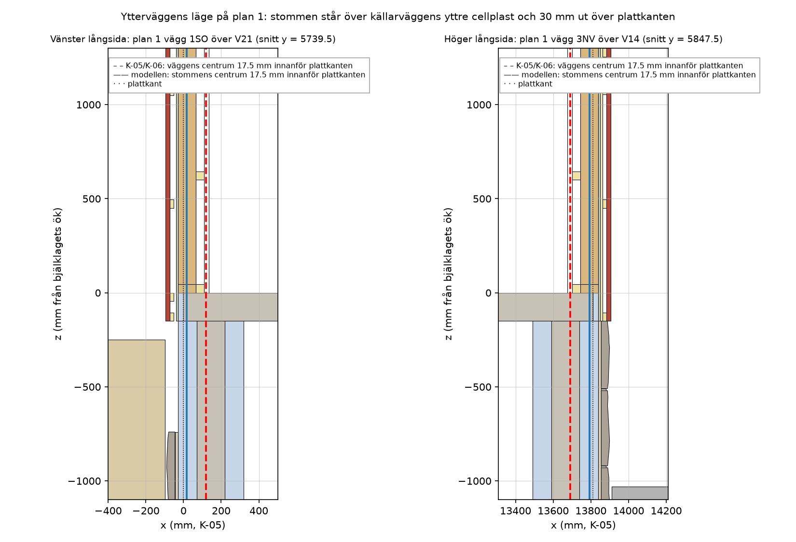

# Lastgeometrin i F-01, K-01, K-05 och K-06 mot modellen

Modell: den kodgenererade modellen (`modeller/trebodar/`), dess senaste bygge. Handlingar: F-01, K-01, K-05 och K-06 med beräkningsfilerna i `beräkningar/`. Tabellerna och figuren tas fram av [`kontroll_laster.py`](../kontroll_laster.py), som läser handlingarnas antaganden direkt ur beräkningsfilerna. Mellanbjälklagets geometri (kontur, trapphål, rör, källarväggar) kontrolleras av [`kontroll_r061.py`](../kontroll_r061.py).

**Omfattning.** Den geometri som bestämmer lasterna: takvinkel, lastbredder, lastytor, höjder, utsprång, lägen för linjelaster och fyllnadshöjder mot källarväggarna. Stödens och stolparnas lägen under nock- och dalbalkarna kontrolleras av [`kontroll_k03.py`](../kontroll_k03.py) (K-03, K-05). Koordinater som i K-05: x, y från skärningen mellan plattkanterna, z från bjälklagets överkant, mm.

## Sammanfattning

Handlingarnas lastgeometri stämmer med modellen eller ligger på säker sida. Mellanbjälklagets geometri i K-05, K-06 och R-06 är modellens, exakt. Ytterväggarna på plan 1 står över källarväggens yttre cellplast, 52,5 mm utanför betongkärnan (figur). Areorna jämförs inte med bygglovets: F-01 anger byggnadsarea 135 + 30 m² och bruttoarea 270 + 30 m² (bygglovet), och modellen ger 159,3 m² för plan 1, mätt till ytterliv, och 126,9 m² bottenplatta i källaren.

Fyllnadshöjderna är markens i modellen intill väggarna: berg, uppfyllnad, återfyllning, avsatserna och källartrappan.

## Tak (F-01, K-01, K-05)

| Storhet | Handling | Modell | Bedömning |
|---|---|---|---|
| Takvinkel | 30° | 30° | stämmer |
| Takbalkar | 45×170 c/c 600 | 45×170, c/c 600 (109 st, glesare vid öppningar) | stämmer |
| Avstånd mellan nockarna (snöbredd dal) | 4,75 m | 4 750 / 4 750 mm | stämmer |
| Lastbredd nockbalk | 2,50 m, största | N3 2,500, N1 2,194, N5 2,194 m | stämmer |
| Lastbredd dalbalk | 2,375 m | 2,375 m | stämmer |
| Nockhöjd | symmetriska huskroppar | mittre nocken 144 mm högre än sidornas, dalarna 125 mm mot sidokropparna | påverkar inte lastbredderna; gavelns topp 0,09 m högre, försumbart |
| Ytterväggens centrum innanför plattkanten | 17,5 mm | 17,5 mm (stommen från 30 mm utanför till 65 mm innanför) | stämmer |
| Väggens höjd till takfot | 2,5 m | 2,49 m | stämmer |
| Takutsprång takfot / gavel | 0,2 / 0,2 m | 0,165 m från plattkanten / 0,03 m | på säker sida |
| Takfotsväggens lastbredd | 1,28 / 1,40 m | 1,25 / 1,38 m | på säker sida |
| Takets planarea, snö på hela taket | 171,6 m², 257 kN | 165,5 m², 248 kN | på säker sida |
| Innertak | 2 × 12,5 mm gips, korslagda reglar 45 mm | 2 × 12,5 mm gips, läkt 45 mm under takbalkarna | stämmer |

## Vind (F-01, K-01)

| Storhet | Handling | Modell | Bedömning |
|---|---|---|---|
| Referenshöjd z | 7,0 m | cirka 5,6 m (nock 4,05 m och 0,08 m taktäckning över färdigt golv, mark 1,47 m under) | på säker sida |
| e = min(b, 2h), vind längs nocken | 12 m | b = 14,1 m, 2h ≈ 11,2 m, e ≈ 11,2 m | på säker sida |

## Bjälklag (K-05, R-06)

| Storhet | Handling | Modell | Bedömning |
|---|---|---|---|
| Plattans area utan trapphål | 157,22 m² | 156,21 m²: vid plattan på marks fria kanter börjar betongen 70 mm innanför plattkanten, vid L-elementens rygg, utom i hörnens urtag (1,01 m²) | stämmer (K-05 räknar plattan till kanten) |
| Kontur | 13 810 × 15 900, 12 hörn | samma | stämmer |
| Tjocklek | 150 mm | 150 mm | stämmer |
| Trapphål | 2 070 × 828, hörn (7 348; 5 059,5) | samma | stämmer |
| Rör P1–P19 | modellens lägen | samma (två rör i P7) | stämmer |
| Källarväggar V1–V21 | modellens centrumlinjer och ändar | samma | stämmer |
| Plattan på mark | 29,3 m² | källarväggarna V3/V20 inom 5 mm från K-05 | stämmer |
| Trappan | 3,0 m lång, 0,83 m bred | 3,06 m längs lutningen, 0,828 m bred (hålet 0,828 m) | stämmer |

## Källare (K-05, K-06)

| Storhet | Handling | Modell | Bedömning |
|---|---|---|---|
| Fri höjd, rörens längd | 2 100 mm | 2 100 mm, 20 rör | stämmer |
| Källarväggar, Kub 350-150 | cellplast 100 + betongkärna 150 + cellplast 100, ytterliv 30 mm utanför plattkanten | samma (V14) | stämmer |
| Golvyta för nyttig last | 133 m² (359 kN / 2,7) | 111,7 m² innanför väggarna | på säker sida |
| Bottenplatta | 100 mm i hela källaren, 126,9 m² (K-06, R-04) | 126,9 m² betong | stämmer |

## Fyllning mot källarväggarna (K-06), höjd över bottenplattans överkant

| Vägg | K-06 | Modell | Bedömning |
|---|---|---|---|
| V1 | 1,8 m | 1,23–1,53 m fyllning | på säker sida |
| V2 | 2,0 m | 1,56–1,83 m återfyllning | på säker sida |
| V3 | 1,75 m | plattan på mark intill väggen | se under plattan på mark |
| V7 | 2,0 m | 1,50 m avsats | på säker sida |
| V9 | 0 → 0,8 m | 0 → 0,80 m källartrappan | på säker sida |
| V10–V13 (fasaden med öppningar) | 0,80 m | 0,79 m fyllning | stämmer |
| V14 | 0,8 → 1,8 m | 0,84 → 1,18 m fyllning | på säker sida |
| V16 | 2,0 m | 1,47–1,57 m berg och återfyllning | på säker sida |
| V18 | 2,0 m | 1,41–1,50 m avsats | på säker sida |
| V20 | 1,75 m | plattan på mark intill väggen | se under plattan på mark |
| V21 | 2,0 m | 0,92–1,27 m fyllning | på säker sida |
| Under plattan på mark | 350 mm cellplast på fyllning och makadam upp till 1,75 m | samma | stämmer |

## Inte granskat

Fasadstenens infästning finns inte i modellen.
